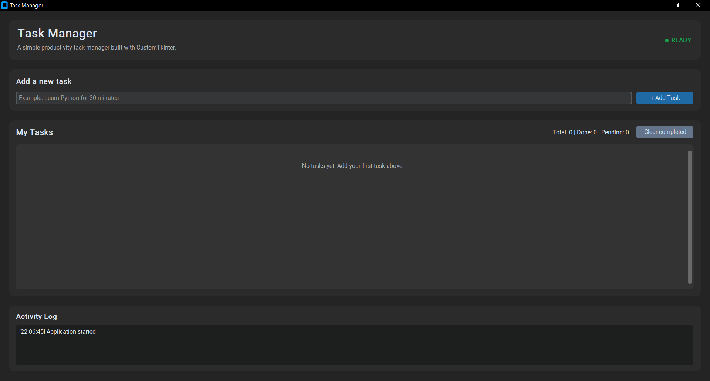
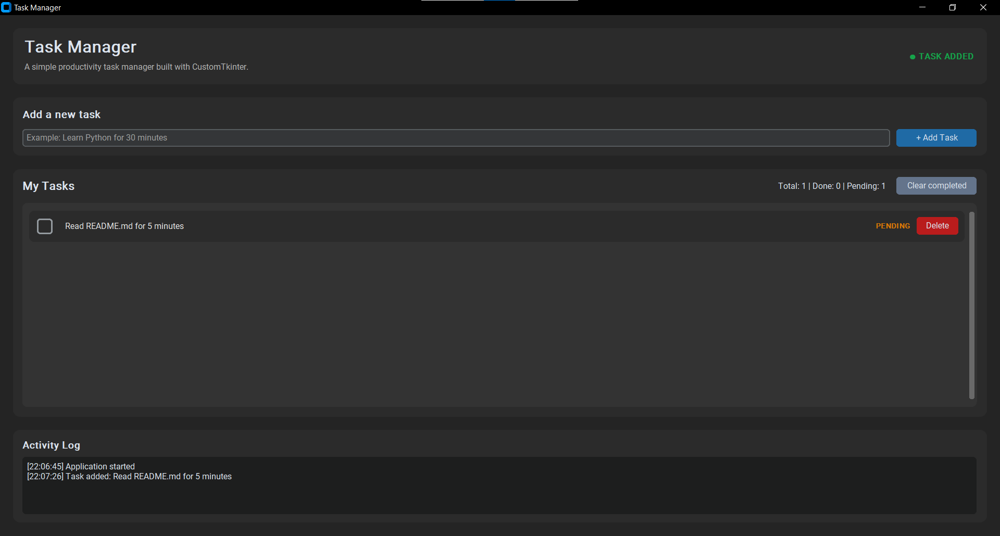
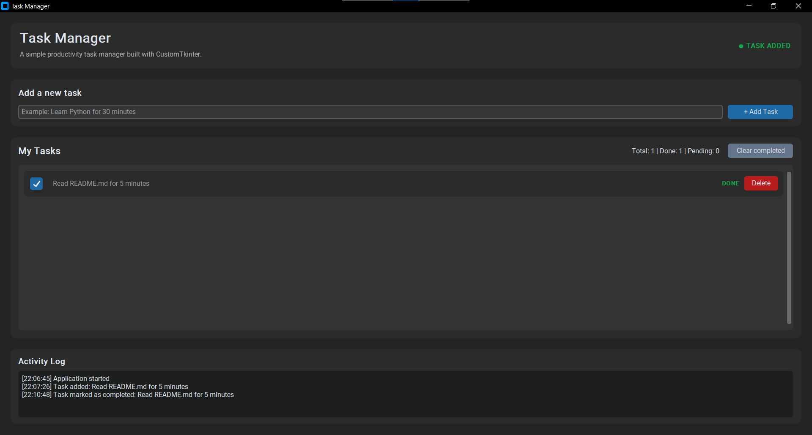

# Task Manager — CustomTkinter

A simple desktop Task Manager application built with Python and CustomTkinter.

## Preview

### 1. Main Interface
The main window displays the task list, task statistics, and activity log.



### 2. Adding a Task
Users can add new tasks to the task list using the input field.



### 3. Completing a Task
Tasks can be marked as completed or pending to track progress.



## Installation

Install the required dependencies:

```bash
python -m pip install -r requirements.txt
```

Or install CustomTkinter directly:

```bash
python -m pip install customtkinter
```

## Run the Application

```bash
python main.py
```

## Features

- Add tasks
- Mark tasks as completed or pending
- Delete individual tasks
- Clear all completed tasks
- Live task statistics
- Activity log
- Save and load tasks using `tasks.json`
- Dark appearance

> **Note:** The application creates `tasks.json` in the same directory as `main.py` when the first task is saved.